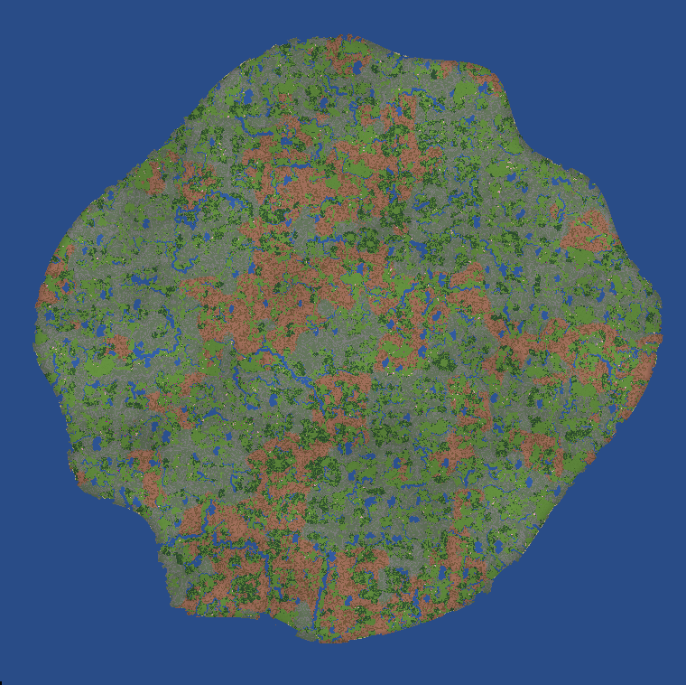

# Île Mini Ninjas

Une île de 6000 × 6000 blocs pour **Minecraft Java 1.20.1**, sans aucun mod : relief, rivières, lacs, falaises, forêts de pins, de feuillus et de cerisiers. Il n'y a rien de construit et personne dessus.

## Installer

1. Télécharger le dépôt : bouton vert **Code**, puis **Download ZIP**, et décompresser.
2. Copier le dossier **`Ile Mini Ninjas`** dans le dossier `saves` de Minecraft (`%appdata%\.minecraft\saves` sous Windows).
3. Lancer Minecraft Java 1.20.1, puis **Solo**, **Ile Mini Ninjas**.

Le monde s'ouvre en créatif, commandes autorisées. Au-delà de l'île, c'est un océan plat de la même profondeur.

## À savoir

- La version 1.20.1 est celle d'origine ; une version plus récente convertit le monde à l'ouverture (faire une copie avant).
- Les arbres et les roches sont des blocs de Minecraft (épicéa, chêne noir, cerisier, pierre, granit, gravier, sable).
